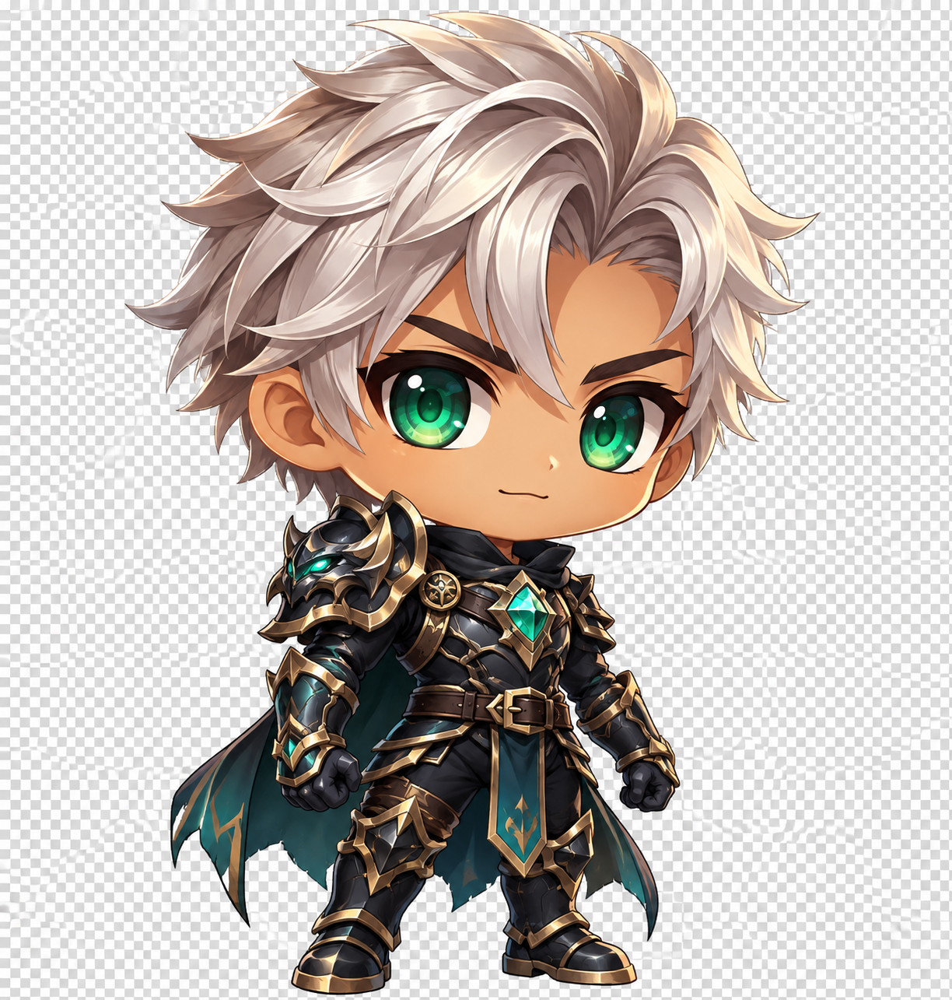

# Art Direction · Herovera

Stand: 05.10.2026. Verbindlicher Qualitätsbrief für Figuren, Garderobe und VFX. Die bestätigte Bildrichtung („in die Richtung perfekt“) und der anschließende Wunsch nach der **exakten Vorlage** bleiben maßgeblich. Neue Varianten erweitern diese Richtung; sie ersetzen die archivierte Originalzeichnung nicht. Produktregeln und Roadmap stehen im [Master Prompt](MASTER_PROMPT.md), tatsächliche Prüfungen in [VALIDATION](VALIDATION.md).



## Gemeinsame Formensprache

Eigenständige, stilvolle Anime-Chibis in leichter Dreiviertelansicht nach Bildrechts: ausdrucksstarke, klar gefasste Augen mit Jewel-Iris, definierte Haarsträhnen, kontrollierte Konturen und gemalte 2.5D-Tiefe. Stofffalten, Nähte, Lederlagen, gefaste Metallkanten und gezielte Glanzlichter erklären Material und Funktion. Große Anime-Augen sind erlaubt; neue modulare Figuren dürfen ungefähr 2,8–3 Köpfe hoch sein, damit Körper, Haltung und Kleidung sichtbar bleiben. Dies ist eine Zielproportion für neue Assets, kein nachträglicher Eingriff in die vier Originalbilder.

Männliche und weibliche Figuren erhalten dieselbe Qualität. Gesicht, Kiefer/Brauen, Schulterbreite, Haltung und Kleidungssilhouette machen die Darstellung lesbar, ohne Sexualisierung oder verpflichtende Klischee-Accessoires. Alle Figuren sind bekleidet. Hauttöne und Darstellung sind ausschließlich visuell, ohne demografische Zuschreibungen, Fähigkeiten oder Statboni. Jede Stilfamilie ist für beide Darstellungen vorgesehen; technische Ankerkompatibilität eines Moduls begründet keine spielerische Stilsperre.

Die Figuren sollen unterschiedliche Altersgruppen ansprechen: zugänglich, sympathisch und zugleich markant genug für anspruchsvollere Looks. Das ist ein Gestaltungsziel, keine zugesicherte Altersfreigabe oder belegte Markt-/Zielgruppenwirkung. Die Wirkung ist später mit Nutzern und auf den vorgesehenen Displays zu prüfen.

| Stilfamilie | Qualitätsbrief für zusammenhängende Sets |
|---|---|
| Cozy | Hochwertige Freizeitkleidung, weiche Stoffflächen, Hoodie/Kapuzenjacke, Nähte, Taschen und passende Sneaker. Süße Details bleiben möglich. |
| Adventurer | Asymmetrische Reisekleidung, Mantel und Lederlagen, praktische Taschen, Handschutz und robuste Stiefel. |
| Elegant | Lange ruhige Stoffflächen, präziser Schnitt, fein gefasste Metalle und sparsame Schmuckdetails. |
| Dark | Strukturierte Gunmetal-Plattenrüstung, plausible Schulter-/Arm-/Beinübergänge, Cape und klare dunkle Materialabstufung. |
| Abyssal | Mächtige Obsidian-/Void-Rüstung, geschichtete Platten, markanter Kristallkern und scharfe eigenständige Rückenformen. |

Stil, Seltenheit, Skills und Klasse bleiben unabhängig. Dunkle Rüstung mit rosa Blütenaura ist zulässig. Figuren, Garderobe, Lore, Symbole, Musik und VFX bleiben eigene IP.

## Aktueller Bild- und Creator-Stand

Der Creator verwendet ausschließlich die illustrierten Figuren. Der frühere Vektor-Editor ist aus der UI entfernt. `ILLUSTRATED_CHARACTERS` führt zwölf Startdesigns mit je sechs Frisuren und Outfitsets pro Darstellung. Die Tabelle beschreibt die gestalteten Kombinationen; befestigte Gegenstände sind derzeit Teile des Bildsets, keine einzeln ausrüstbaren Items.

| Design / ID | Haare | Vollständiges Outfit, Waffe und Accessoires |
|---|---|---|
| M · Smaragdwächter · `emerald-knight` | Silberne, gestaffelte Spikes | Schwarzgold-Plattenrüstung, Smaragdkern, Schulter-/Armschutz, dunkelteales Cape und Panzerstiefel; im Original keine gehaltene Waffe. |
| M · Urbaner Abenteurer · `urban-ranger` | Dunkelbrauner Messy Cut | Dunkle Jacke über Teal-Hoodie, Cargohose, fingerfreie Handschuhe und High-Tops; Gürteltasche, Anhänger und kleine Metallbeschläge; keine gehaltene Waffe. |
| M · Frostgelehrter · `frost-scholar` | Aschblaue, mittig geteilte Curtains | Navy-Ivory-Gelehrtenmantel, Weste, silberne Kanten und hohe Stiefel; befestigtes Buch und Kristallanhänger; kein Stab. |
| M · Glutkämpfer · `ember-striker` | Kurze kupferrote, aufgerichtete Strähnen | Rot-anthrazites Trainingsgewand über sportlichem Shirt, Stoffgürtel, Bandagen/Trainingshandschuhe und Trainingsstiefel; kleiner Glutanhänger; keine Waffe. |
| M · Waldläufer · `forest-scout` | Dunkelbrauner Topknot, kurze Seiten | Grüner Ledermantel mit zurückgelegter Kapuze, Armschutz, Handschuhe, Hose und Riemenstiefel; Utility-Taschen, Blattbeschläge sowie am Rücken befestigter Bogen/Köcher. |
| M · Abgrundwanderer · `abyss-walker` | Schwarzer Undercut mit kantiger seitlicher Oberpartie | Obsidianrüstung mit violettem Kern, überlappenden Schulterplatten, Panzerhandschuhen/-stiefeln und Cape; gerade Klinge in befestigter Hüftscheide. |
| W · Nachtklinge · `moonblade` | Violetter Bob mit seitlichem Flechtdetail | Dunkle Plattenrüstung mit Goldkanten, violetten Kristallen und Cape, Handschuhen und Panzerstiefeln; Haarschmuck; im Original keine gehaltene Klinge. |
| W · Sternenweberin · `starweaver` | Langer brauner Seitenzopf | Ivory-Gold-Reisemantel über dunklen Lagen, Teal-Schärpe, Hose, Handschuhe und Lederstiefel; Gürteltasche, Kristallanhänger und Zopfband; keine gehaltene Waffe. |
| W · Morgenhüterin · `dawn-priestess` | Lange goldene Wellen | Geschlossener Ivory-Gold-Mantel über dunklen Robenlagen, Handschuhe und helle Stiefel; Kristallamulett, Gürtelbuch sowie blaugoldener Haarschmuck; keine Waffe. |
| W · Rosenläuferin · `rose-runner` | Rotbrauner hoher Pferdeschwanz | Rosé-Cream-Kapuzenjacke, sportliche dunkle Hose und High-Top-Sneaker; kleine Tasche, Arm-/Haarbänder; keine Waffe. |
| W · Leerenweberin · `void-sorceress` | Dunkle Pflaumentöne, Twin Tails | Geschlossene Obsidian-Violett-Robe mit Rüstungslagen, Silberkanten, Armschutz und Stiefeln; befestigtes Grimoire und eingefasster Orb, Kristallhaarschmuck. |
| W · Himmelsjägerin · `sky-ranger` | Silberner Pixie mit Teal-Strähnen | Navy-Teal-Ledermantel über hellem Unterteil, Hose, Cape und Stiefel; befestigter Bogen/Köcher, Gürtelbeutel und Goldbeschläge. |

### Originalansicht und modulare Anpassung

Die vier ursprünglichen PNGs bleiben unverändert als Stilreferenz archiviert. Der aktuelle
Charakterausbau stellt alle zwölf Vorlagen auf denselben Layer-Renderer um: zwölf separat
gerenderte, vollständig bekleidete Körper-Sprites mit eigenen Outfitankern werden mit den
jeweils einem vollständigen gemalten Kopf aus der gewählten Frisurenvariante kombiniert. Dadurch wechselt eine Farb- oder Frisurwahl
nicht mehr zwischen Original-Gesamtbild und einer anderen Komposition. Die neuen Teile sind
keine pixelidentische Zerlegung der vier Originalzeichnungen. Die abschließende Sichtprüfung
aller Kragen, Haare und Kombinationen auf Handy/Tablet ist noch offen.

Frisur und Outfitset lassen sich unabhängig innerhalb des passenden Darstellungskatalogs
wählen. Haut-, Augen- und Haarfarben bieten jeweils „Original“ plus sechs Palettefarben.
Eine Vorlagenwahl setzt diese Anpassungen zurück. Outfits sind vollständige bekleidete Sets;
ihre Farben, Waffen und Accessoires haben noch keine eigenen Slots.
`art/chibi-style-reference.png` bewahrt die bestätigte 1224 × 1285-Vorlage; ihr Schachbrett
ist eingebrannt und darf nicht als echter Alphakanal ausgegeben werden.

Die Frisurenwahl entscheidet über **einen vollständigen gemalten Kopf** einschließlich
zusammengehöriger Haare, Gesicht, Ohren, Kiefer und Augen. Kleidung bleibt unabhängig.
Die Laufzeit verwendet weder ein fremdes Vorlagengesicht noch eine zusätzliche Stirnfüllung.
Ohne explizite Augenfarbe gilt die gemalte Augenfarbe des gewählten Kopfes; eine gesetzte
Augenfarbe bleibt erhalten. Haut-, Augen- und Haartönung verwenden Regionen desselben Bildes.
Ein eigener Gesichtswechsel unabhängig von der Frisur ist im aktuellen Renderer nicht vorhanden.
Getrennte Gesicht-/Haarteile bleiben ein späterer Produktionsweg mit exakt passenden Layern.

Die Körper-Sprites besitzen echtes Alpha. Köpfe werden über zwei Irisanker ausgerichtet;
der Kragen trifft unmittelbar den gewählten Kiefer. Neun Portrait-Einheiten Versatz verbergen
vorhandene Halsanteile. Farbmasken und Iris-Ellipsen des selben Kopfes erhalten Schattierung,
Pupillen und Reflexe. Ein eigenes Skelett mit Armen/Händen/Mimik ist noch nicht umgesetzt.
Die abschließende Kombination aller Kopf-/Outfitvarianten bleibt eine visuelle Abnahme.

Ruhige Atmung koppelt Körperdehnung und Kopfbewegung. SVG-Porträts ergänzen kurze Gesten
passend zu Level/Interessen; Pixi nutzt Atmung und Kampfreaktionen. „Bewegung aus“ und
`prefers-reduced-motion` halten Avatar und Aura statisch. Präzise Gesichtsausdrücke,
einzelne animierte Arme und eigenständige Ausrüstungsanimationen bleiben weitere Arbeit.

## Animations- und Bossproduktion

Die neue Szene wird mit PixiJS umgesetzt. Die vorhandene Kopf-/Körperkomposition bleibt ein
Illustrationsadapter, kein vollständiges Skelett. Der Nutzer besitzt keine Spine-Lizenz; aktuell
werden weder Spine-Runtime noch Spine-Exporte ausgeliefert. Ein späterer Spine-Produktionsweg
setzt geklärte Nutzung und passende Assetlieferungen voraus.

Der [Animation Guide](ANIMATION_PIPELINE.md) definiert den nächsten Produktionsauftrag: zuerst
ein männlicher und ein weiblicher Referenz-Chibi mit zwei Haar-/Outfitvarianten sowie ein
Mooswächter-Boss, alle mit Idle, Angriff, Treffer, Sieg und Niederlage. Gemeinsame Aktionsnamen
erlauben unterschiedliche Skelette; Bosse dürfen eigene nichtmenschliche Körperformen haben.
Mooswächter: schwere Stein-/Rindenformen, Moos, Wurzelarme und smaragdener Kern. Die aktuelle Grundform `art/bosses/mosswarden-v2.webp` ist ein einzelner
Sprite, kein mehrteiliges Boss-Rig. Zehn Bossfamilien verwenden je vier eigene Bildformen;
Katalog und aktuelle Assetproduktion stehen in [VISUAL_AUDIO_DIRECTION.md](VISUAL_AUDIO_DIRECTION.md). Figuren, Gegner, Bühne und VFX bleiben eigene IP.

Der Kampf zeigt beide Figuren einander gegenüber, leicht von der Seite. Waffen, Hände, Haare
und Kleidung sollen später zusammenhängend reagieren. Dafür braucht es echte getrennte Teile,
verdeckte Anschlussflächen und fünf abgenommene Clips, keine reine Vergrößerung des Gesamtbilds.
Die bestätigte Originalzeichnung bleibt archiviert und Referenz für Stil/Material; riggbare
Neuzeichnungen werden nicht als pixelidentisches Original ausgegeben.

Bosse sollen die Kampfbühne körperlich dominieren. Der Mooswächter ist in der Demo ungefähr
1,5-mal so hoch wie die sichtbare Heldensilhouette: Boss-Skalierung 1,30, Held 1,00.
Fußanker und Bodenschatten berücksichtigen seine Masse. Auch die statische Ersatzansicht
bewahrt dieses Größenverhältnis. Weitere Bossmodelle erhalten eine eigene Größenabnahme;
Geweihe, Flügel, Rückstoß und Niederlageposen brauchen auf Handy und Tablet Randreserve.

## Garderobe und Produktionsvertrag

Das Zielsystem unterstützt vollständige Sets und separat gefertigte Slots: **Kopf, Gesicht, Haare, Torso, Arme, Beine, Schuhe, Haupthand, Nebenhand, Rücken, Accessoire, Aura und Companion**. Jeder Slot benötigt passende Vorder-/Hinterteile, Abdeckung und Anker. Aktuell sind vollständiges Outfitset, Frisur, Farben sowie Starter- und verdiente Auren wählbar. Fünf Aktivitäts-Auren und zwanzig Boss-Auren sind erspielbar; im Account-Spiel prüft der Server den Besitz. Einzelwaffen, Rüstungsslots und Iteminventar bleiben separate Ausbaustufen.

Für jedes neue Asset gelten diese Abnahmeanforderungen:

- Referenz, Pose, Blickrichtung, Lichtführung und Zielproportion bleiben konsistent. Gelenk-/Halsanschlüsse, beide Irisanker, Fußlinie und Ausrüstungspunkte werden im Rig mit tatsächlichen Pixelmaßen erfasst. Keine abgeschnittenen Haare, Stiefel, Cape- oder Waffenspitzen.
- Vollständige Kleidung wird auch unter Haaren und Accessoires ausgearbeitet. Für spätere Slots bleiben verdeckte Anschlussflächen vorhanden. Für künftig separat gefertigte Gesicht-/Haarteile müssen Basisform, sichtbare Haut und verdeckte Anschlüsse exakt zusammenpassen; aktuell bleibt der vollständige Kopf eine Einheit.
- Der Layerplan ist ausdrücklich festgelegt: Boden-VFX → rückwärtige Aura/Companion/Rückenobjekte → hintere Haare/Cape → Körper/Beine/Schuhe → Arme/Hände/Ausrüstung → Gesicht/Basiskopf → vordere Haare/Kopfschmuck → vordere Partikel und optionale Augeneffekte. Dies ist der Ausbauvertrag; die heutige vereinfachte Körper-/Kopfkomposition bildet noch nicht alle Ebenen separat ab.
- Originalillustration und Labelmaske besitzen für Produktionsfreigabe identische Abmessungen und pixelgenaue Geometrie. Schwarz bezeichnet ausschließlich Hintergrund/Lücken, niemals dunklen Stoff oder innere Nähte. Kleine Gesichtsteile und Irisflächen dürfen nicht versehentlich ausgeschnitten werden.
- Prüfe kurze/lange Haare, helles/dunkles Outfit, jede Palette, Körper-/Halsübergang und die gesamte Silhouette in Handygröße sowie bei vergrößerter Darstellung. Kopf, Gesicht und Hände bleiben korrekt verbunden; keine doppelte Frisur, kahlen Löcher oder schwebenden Teile.
- Definiere vor Produktionsfreigabe messbare Budgets für Download je sichtbarem Portrait, dekodierten Texturspeicher, Texturabmessungen, gleichzeitig aktive Layer/Filter und Aura-Partikel. Die Galerie lädt die statischen Portrait-Vorschauen bereits beim Eintritt in den sichtbaren Bereich. Lade weitere Katalogbilder ebenfalls bedarfsgerecht und verhindere unnötige Animationen außerhalb des sichtbaren Bereichs. Zahlen und gewählte Formate folgen der ersten Geräte-Messreihe; derzeit gibt es keinen belegten Performance- oder Store-Reife-Nachweis für den vollständigen Assetkatalog.

### Bossbelohnungen für beide Darstellungen

Ein Bossabschluss verleiht weiterhin genau **eine Belohnungsfamilie**. Haar und Outfit besitzen
je eine männliche und weibliche Darstellung; Sammlungsbild und passende Modulzuordnung folgen
der aktuellen Charakterdarstellung. Ein Wechsel der Darstellung erfordert keinen zweiten Drop
und vergibt keine doppelte Belohnung. Das sind weiterhin **40 Besitz-IDs**, nicht 60.
Die zwanzig Aura-Belohnungen bleiben für beide Darstellungen gemeinsam. Farben und Aura-Besitz
ändern sich durch diese Varianten nicht.

Die zehn Haar- und zehn Outfitfamilien erhalten zwanzig separate weibliche Sammlungsbilder
unter `art/loot/{loot-id}-female-v1.webp`, 480 × 480 mit echtem Alpha. Unterschiedliche
Flecht-, Wellen-, Bob-, Pixie- und Hochsteckformen sowie eigene Bekleidungssilhouetten bewahren
Bossfarben und Materialidentität. Alle Sets sind vollständig bekleidet. Die vorhandenen
Basisdateien bleiben als männliche Zuordnung erhalten. Vollständige Passformprüfung der
tatsächlich ausgerüsteten Module erfolgt getrennt von der Sammlungsbild-Abnahme.

## Aura-Richtung und Freischaltung

Auren rahmen die **ganze Figur** mit mehreren Tiefenebenen ein. Bodenzeichen verankern sie, rückwärtige Formen geben Präsenz, wenige vordere Partikel schaffen Tiefe. Gesicht und Hände bleiben sichtbar; Effekte blockieren keine Berührung, Navigation oder Texte. Dunkle, helle, süße und kraftvolle Effekte sind für jede Figur vorgesehen. Farbpaletten gehören fest zum jeweiligen Design. Neue Farbvarianten sind eigene Freischaltungen; freier Farbpicker und Aura-Labor sind entfernt.

Die ersten zehn Bossmotive behalten folgende Namen und IDs; der vollständige 20er-Boss-Aura-Katalog steht in `boss-loot.ts`:

| Aura | Motiv | ID |
|---|---|---|
| Sternenspuren | Sternspuren, kleine Konstellationen und Lichtsplitter | `stars` |
| Mystischer Schleier | Eigene magische Zeichen, Kreisformen und Lichtbänder | `mystic` |
| Innere Harmonie | Chakra-/Lotus-inspirierte Fantasy-Energie ohne Gesundheitsversprechen | `chakra` |
| Dämonenschatten | Dämonische Energie, kantige Schatten, optional bedrohlicher leuchtender Blick | `demonic` |
| Lichtkrone | Strahlenkrone, ruhiges helles Leuchten | `light` |
| Energiefluss | Aufsteigende Energie und einzelne elektrische Akzente | `energy` |
| Himmelsflügel | Engelsartige Lichtflügel und luftige Federmotive | `angel` |
| Blütenwind | Kirschblüten, Blütenzweige und schwebende Blätter | `blossom` |
| Flammenherz | Flammen, warme Glut und aufsteigende Funken | `fire` |
| Geistwächter | Große durchscheinende, eigenständig entworfene Schutzgestalt | `guardian` |

Die vom Nutzer genannten Saijajin-/Naruto-Susano-Vorbilder dienen nur als Genre-Inspiration für aufsteigende Energie und eine beschützende Erscheinung. Keine konkreten Designs, Körperformen, Symbole, Attacken, Namen oder Audiodateien dieser Franchises übernehmen. Effekte sind kosmetisch und bewerten weder Psyche noch Gesundheit.

Die tatsächlich angelegte Aura verwendet auf Dashboard, im Creator und in der Pixi-Kampfbühne dieselbe gemalte Grafik. `AURA_VISUALS` ist die einzige Zuordnung von Aura-ID zu Bild, Position, Größe, Deckkraft und Bewegungsart im gemeinsamen Portraitformat 240 × 300. `CharacterAura` und `createAuraLayer` lesen diese Registry; alte Linien-/Outline-Auren werden nicht parallel eingeblendet.

Die aktuelle Bibliothek umfasst **26 transparente WebP-Dateien** für 26 Aura-IDs: sechs
Zeichnungen für `sage`, `rose`, `void`, `aurora`, `starlight` und `moss-spirit`
(512 × 640), zehn bestehende Boss-Auren (480 × 480) und zehn neue Boss-Auren (600 × 750).
Dämmerungsbestie, Blutmondregentin, Nharok, Vaelthar und Aureon erhalten jeweils zwei eigene
Bilder mit freier Mitte für den Chibi. Die ehemaligen Dämmerungs-/Blutmond-Tönungsaliase
sind ersetzt. Die neuen Master, Prompts und Alpha-Prüfungen liegen unter `art-source/loot/`.

Nur **Ohne Aura und Waldlicht (`sage`)** sind Starter. **Rosenlicht (`rose`) bei Level 5,
Schattenflamme (`void`) bei Level 10, Nordlicht (`aurora`) bei Level 20, Sternenkranz
(`starlight`) bei Level 40 und Moosseele (`moss-spirit`) beim Aktivitäts-Wochenboss-Sieg**
sind fünf einmalige Aktivitätsbelohnungen. Zwanzig Kampagnen-Auren stammen aus epischen und
ultimativen Erst-Siegen. Server und Creator prüfen Besitz. Laden und Duplikate vergeben nichts;
eine enge Migration erhält früher gültiges Rosenlicht-/Schattenflamme-Eigentum.

Das freie Aura-Labor mit Farbwahl und Schattenblickregler ist entfernt. Gesichtsausdruck
und präzises Irisleuchten bleiben spätere Parameter mit eigenen Masken/Ankern. Neue Bilder
ändern keine Freischaltregeln und verleihen weder XP noch Stats.

Für Abnahme und weitere Arbeit gelten:

- Eine gespeicherte Aura erscheint nach Reload mit demselben Registry-Bild auf Dashboard, im Creator und am kämpfenden Helden. Die Pixi-Aura folgt dem Helden hinter dessen Figur; sie darf Gesicht, Kragen und Bedienung nicht verdecken.
- Pro dargestellter Aura nur das gewählte Asset laden. Im Kampf höchstens ein Aura-Sprite, kein eigener Aura-Ticker, begrenzte Texturgröße und Freigabe von Bitmap/Textur beim Verlassen oder Abbruch. DOM-Effekte pausieren außerhalb des Sichtbereichs; die Kampfszene pausiert bei verborgenem Fenster beziehungsweise außerhalb des Sichtbereichs.
- Bewegung aus und `prefers-reduced-motion` zeigen weiterhin das gemalte Bild ruhig an. Keine schnellen Blitze. Farben folgen dem freigeschalteten Design; keine frei umgefärbte Vorschau anbieten.
- Unbekannte IDs und „Keine“ erzeugen keine Bildanfrage. URLs kommen ausschließlich aus der Registry. Ein Ladefehler darf den Kampf nicht verhindern: im DOM ist ein dezentes Ersatzleuchten erlaubt, in Pixi entfällt das defekte Aura-Bild. Kein Rückfall auf die alten Outline-Entwürfe und kein endloses Neuladen desselben defekten Bilds.
- Eigentums-, Aktivitäts- und Erst-Sieg-Regeln bleiben unverändert. Die Renderer vergeben weder Beute noch XP. Visuelle Abnahme auf Handy/Tablet und echte Geräte-Performance bleiben zusätzlich zu Quellcode- und Testprüfungen erforderlich.

### Vollständiger Kopf ohne alte Haarreste

Die aktive Komposition verwendet genau einen vollständigen Kopf pro Frisurenvariante.
Sie hält keine alte Haarform, kein separates Vorlagengesicht und keine Stirnfüllung darunter.
Farbvarianten werden mit `REGION_ALPHA` über dieselbe Kopfzeichnung gelegt; die Maske ist
ein Farbkanal, kein zweites Gesicht. So wird der frühere konstruktive Ursprung von
Haarresten und doppelten Kieferkanten entfernt. Kragenüberdeckung und gekoppelte Atmung
gelten in SVG/Pixi gemeinsam. Kurze/lange Frisuren, Haut-/Augenfarben und Halsanschluss
müssen dennoch sichtbar geprüft werden. Einzelne Zähltests ersetzen diese Abnahme nicht.

## Verbindliche kreative Einflüsse

Warcraft/World of Warcraft, Final Fantasy IV, V, VI, VII, VIII, IX, X, XII, XIII, XIV, XV, XVI und Journey to the West bilden den gewünschten Inspirationsrahmen. Die konkrete Zuordnung und ihre Anwendung auf Figuren, Rüstungen, Welt, Bosse und Effekte stehen in [Einflüsse und Umsetzung](art/INFLUENCES.md). Bestehende bestätigte Chibi-Proportionen und eigenständige IP bleiben verbindlich. Die stärksten Anleihen liegen in klaren Silhouetten, ausdrucksstarker Fashion, stimmigen Elementen und angekündigten Bossfähigkeiten.

## Wiederverwendbarer Produktionsprompt

Der folgende Prompt dient Illustrationen und bestehenden Maskenvarianten. Für neue animierbare
Figuren und Bosse zusätzlich den Liefervertrag in [ANIMATION_PIPELINE.md](ANIMATION_PIPELINE.md)
verwenden: getrennte Gelenkteile, Rigquelle, Clips und versionierte Textur-/Atlasdaten. Ein flaches
Modulsheet und eine Labelmaske allein erfüllen diesen neuen Animationsauftrag nicht.

Vor Verwendung die Felder ausfüllen und die passende Original-/Modulreferenz tatsächlich anhängen. Für ein neues Asset wird ausschließlich der benannte Slot verändert. Bestehende Originaldateien bleiben archiviert; Generation und Maskenprüfung sind getrennte Schritte. Das folgende Template beschreibt den Zielvertrag, keine Garantie pixelgenauer Generatorausgabe.

```text
Aufgabe: Erzeuge [ASSET_ID] für Herovera als [HAAR / OUTFITSET / RÜSTUNGSSLOT /
HAUPTHAND / NEBENHAND / RÜCKEN / ACCESSOIRE / AURA]. Eigenständige IP.
Referenz 1: bestätigte Anime-Chibi-Illustration für Gesicht, Stil und Materialqualität.
Referenz 2: passendes bestehendes Modulsheet für Pose, Leinwand und Anschlüsse.
Referenz 3, falls vorhanden: gültige Maske/Rig-Ansicht für exakte Slot-Geometrie.

Design: [STILFAMILIE, SILHOUETTE, FARBEN, MATERIALIEN, ZWECK DES GEGENSTANDS].
Darstellung/Basis: [MALE/FEMALE, BASIS-ID]. Gemalte Anime-2.5D-Tiefe,
klare Haarsträhnen, Jewel-Augen, kontrollierte Kontur und gerichtete Highlights.
Unsexualisiert, vollständig bekleidet, Körper und Kleidung lesbar.
Leichte Dreiviertelansicht nach Bildrechts, ruhige Standpose mit beiden Füßen.
Neue Figuren ungefähr 2,8–3 Köpfe hoch; bestehende Referenzproportionen erhalten.

Invarianten: exakte [BREITE × HÖHE], [DIVIDER], [HALS-/IRIS-/FUSSANKER],
[HAND-/RÜCKENANKER], gleiche Kamera und Lichtquelle. Ändere nur den beauftragten
Slot. Gesicht, Ausdruck, Haut, unbetroffene Haare/Kleidung und Lage bleiben erhalten.
Keine zusätzlichen Figuren, Schriften, Logos, Szenen, schwebenden Gegenstände oder
abgeschnittenen Spitzen. Keine übernommenen Franchise-Symbole oder Silhouetten.

Für ein vollständiges Modulsheet: reiner schwarzer Hintergrund. Links vollständiger
KOPFLOSER bekleideter Körper mit Halsanschluss, Armen/Händen, Beinen/Schuhen,
Cape und befestigten Set-Accessoires. Kleidung auch unter später verdeckten Flächen
vollständig zeichnen. Rechts isolierter vollständiger Kopf mit Gesicht und ALLEN
Haaren einschließlich Zopf/Twin Tails. Kein Teil überschreitet den Divider.

Für einzelne Haare/Rüstung/Waffen/Accessoires: [SLOT-REGION / FRONT-BACK-LAYER]
auf der unveränderten Leinwand und an den festgelegten Ankern. Restfläche leer.
Verdeckte Anschlussflächen fertig zeichnen. Keine Hand an eine isolierte Waffe
backen, wenn die Hand als separater Layer vereinbart ist. Aktuelle komplette
Outfitsets dürfen ihre befestigten Gegenstände behalten.

Für Aura: getrennte Ebenen [BODEN / HINTEN / VORNE / OPTIONAL AUGEN], Motiv
[AURA-NAME], Farbe [FARBE], Intensität [RUHIG/KRAFTVOLL]. Figur selbst nicht
mitzeichnen oder verändern. Gesichtsbereich freihalten. Keine Blitzfolge.
Augeneffekt nur an den zwei vorgegebenen Irisankern, unabhängig von Mimik.
Liefere [EINZELFRAME / EXAKT DEFINIERTE FRAMEANZAHL UND RASTER] gemäß Rig.
```

Semantische Maske für Körper/Kopf/Haare als separater Edit-Auftrag auf dem fertigen Sheet:

```text
Erzeuge eine flache Labelmaske des angehängten fertigen Assets. Exakt dieselben
Pixelabmessungen, Umrisse, Anordnung und Anker. Nichts neu gestalten oder verschieben.
#000000 = ausschließlich Hintergrund und echte Zwischenräume.
#ff0000 = sämtliche Haare, kein Gesicht oder Kleidung.
#0000ff = tatsächlich sichtbare Haut: Gesicht, Ohren, Hals und freie Hände.
#ffffff = nur die beiden kompletten Irisflächen einschließlich Pupille und Reflexen.
#00ff00 = übriger Figurenvordergrund: Kleidung, Rüstung, Handschuhe, Waffen,
Accessoires sowie Augenbrauen, Augenweiß, Lidkontur und Mund.
Keine Schattierung, Textur, schwarzen Pupillenlöcher oder dunklen inneren Nähte.
Keine blaue Maske auf Handschuhen. Keine weiße Maske auf Augensclera.
Geringes Rand-Antialiasing, sonst ausschließlich die fünf festgelegten Farben.
```

Für neue Ausrüstungsslots und Aura-Ebenen sind eigene Deckungs-/Materialmasken und ein dokumentierter Layervertrag zu liefern; die aktuelle Kopf/Körper-Farbkarte codiert diese zukünftigen Slots nicht automatisch. Prüfe Original, Maske und zusammengebaute Figur sichtbar, bevor Dateien als freigegeben gelten. Dokumentiere exakten Prompt, Quellpfade, Maße, Anker, verworfene Versuche und bekannte Grenzen unter `docs/art/`. Der [Originalprompt](art/chibi-style-prompt.md), die [Produktionsprompts](art/character-production-prompts.md) und die jeweiligen `*-prompts.md` bleiben als Provenienz erhalten.
