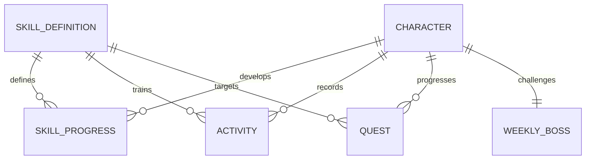

# Domain Model · V0.1

## Implementierter Slice

| Typ | Verantwortung / zentrale Felder |
|---|---|
| Character | ID, Name, Title, Gesamt-XP, Basisattribute, Appearance |
| Appearance | Körper-/Haar-/Outfit-/Aura-IDs und Farben; minimaler Platzhalter im Slice |
| SkillDefinition | ID, Name, Familie, Attribut, XP pro Minute, Tageslimit |
| SkillProgress | Skill-ID + Gesamt-XP; Level wird berechnet |
| Activity | Request-ID, Skill-ID, ganze Minuten, belohnte Minuten, Day-Key, XP |
| Quest | ID, Skill-ID, Zielminuten, Fortschritt, einmaliger XP-Bonus, claimed |
| WeeklyBoss | ID, Name, Woche, Max-HP, aktuelle HP; Phase wird berechnet |
| Momentum | Wert 0–100, letzter belohnter Tag, Wochenrhythmus als Mock-Snapshot |
| GameSnapshot | Aggregierter Zustand für das Dashboard inkl. Aktivitäten und Perioden-Key |
| ActivityResult | Neuer Snapshot + Aktivitäts-XP, Quest-XP, Damage, belohnte Minuten, duplicate |

## Invarianten

- Einheiten: Minuten als positive ganze Zahl; XP/HP als nichtnegative ganze Zahl.
- Charakter-/Skill-Level und XP-in-Level werden aus Gesamt-XP abgeleitet, nicht doppelt gespeichert.
- Nur akzeptierte belohnte Minuten geben XP und Questfortschritt. Restliche Minuten bleiben im Log.
- Questbonus genau einmal. Questfortschritt ≤ Ziel; HP ∈ [0, maxHP]; Momentum ∈ [0, 100].
- Request-ID ist idempotent innerhalb des Charakters; abweichende Payload unter derselben ID ist Fehler.
- Ein unbekannter Skill oder ungültiger Command verändert keinen Teilzustand.
- Membership-Multiplikator, Loot, Streak-Neuberechnung und Periodenwechsel sind nicht simuliert.

## Erweiterungen und spätere Tabellen

`users` 1:1 `characters`; `skill_definitions` mit optionaler Parent-ID; `character_skills`;
`activity_logs` (unique user/request); `quest_definitions` + `quest_instances` (user/period);
`boss_definitions` + `boss_encounters`; später `day_plans`, `inventory_items`, `equipment_slots`,
`cosmetics`, `achievements`, `character_achievements`, `titles`, `entitlements`.

Aktivitätslog ist der Audit-Pfad. Abgeleitete Projektionen (XP, Quest, Boss) werden serverseitig
transaktional aktualisiert. Member-Zugang gehört zu Entitlements, kosmetische Darstellung zu
Appearance, Skill-Level zu Progression. Diese Begriffe dürfen keine gemeinsame „alles kann alles“-Entity bilden.

Für spätere Streaks brauchen wir Zielrhythmus, geplante Trainingstage und abgeschlossene Perioden.
Ein einzelner Zahlenwert „streak“ genügt fachlich nicht. Weekly Quests teilen den Quest-Typ mit
einem expliziten Periodenschlüssel; die Demo enthält ausschließlich Tagesquests.
