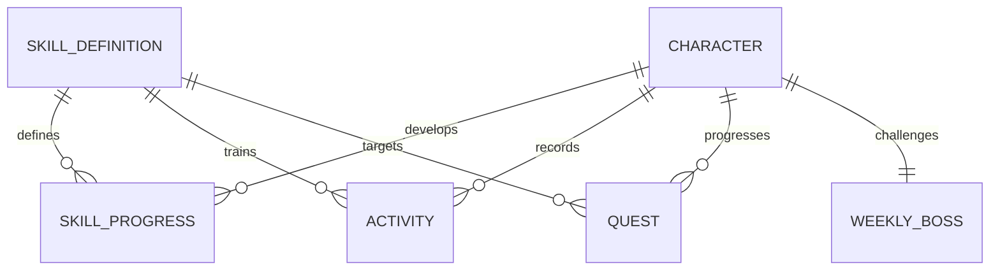

# Domain Model · V0.3

## Implementierter Slice

| Typ | Verantwortung / zentrale Felder |
|---|---|
| Character | ID, Name, Title, Gesamt-XP, Basisattribute, Appearance, createdByPlayer |
| CharacterProfile | Nur Name und Appearance; separat vom Fortschritt lokal gespeichert |
| Appearance | presentation (`male`/`female`), Körper-/Haar-/Outfit-/Aura-IDs sowie Haut-, Haar- und Outfitfarbe |
| SkillDefinition | ID, Name, Familie, Attribut, XP pro Minute, Tageslimit |
| SkillProgress | Skill-ID + Gesamt-XP; Level wird berechnet |
| Activity | Request-ID, Skill-ID, ganze Minuten, belohnte Minuten, Day-Key, XP |
| Quest | ID, Skill-ID, Zielminuten, Fortschritt, einmaliger XP-Bonus, claimed |
| WeeklyBoss | ID, Name, Woche, Max-HP, aktuelle HP; Phase wird berechnet |
| Momentum | Wert 0–100, letzter belohnter Tag, Wochenrhythmus als Mock-Snapshot |
| GameSnapshot | Aggregierter Zustand für das Dashboard inkl. Aktivitäten und Perioden-Key |
| ActivityResult | Neuer Snapshot + Aktivitäts-XP, Quest-XP, Damage, belohnte Minuten, duplicate |
| Milestone | Übergangsart, Titel und Detail; aus akzeptiertem Vorher/Nachher berechnet, nicht persistiert |

## Invarianten

- Einheiten: Minuten als positive ganze Zahl; XP/HP als nichtnegative ganze Zahl.
- Charakter-/Skill-Level und XP-in-Level werden aus Gesamt-XP abgeleitet, nicht doppelt gespeichert.
- Nur akzeptierte belohnte Minuten geben XP und Questfortschritt. Restliche Minuten bleiben im Log.
- Questbonus genau einmal. Questfortschritt ≤ Ziel; HP ∈ [0, maxHP]; Momentum ∈ [0, 100].
- Request-ID ist idempotent innerhalb des Charakters; abweichende Payload unter derselben ID ist Fehler.
- Ein unbekannter Skill oder ungültiger Command verändert keinen Teilzustand.
- Membership-Multiplikator, Loot, Streak-Neuberechnung und Periodenwechsel sind nicht simuliert.
- Profilmutation ist unabhängig von Fortschritt: Name/Aussehen ändern keine XP, Quest oder Bossdaten.
- Profilnamen: normalisiert und getrimmt, 2–24 Unicode-Codepoints, definierte erlaubte Zeichen.
  Appearance verwendet bekannte IDs und gültige sechsstellige Hexfarben; keine beliebigen Asset-URLs.
- `presentation: 'male' | 'female'` ist ausschließlich eine gewählte visuelle Darstellung. Sie
  beeinflusst keine Stats, XP, Skills oder Berechtigungen und beschreibt kein demografisches Profil.
- `hair` muss zum Katalog der ausgewählten `presentation` gehören; neue Version-2-Eingaben mit
  alter/unbekannter ID oder fremder Haarzuordnung werden abgewiesen.
- Version 2 der lokalen Profilhülle enthält nur `version` und `profile`; XP, Interessen und
  Kaufberechtigungen gehören nicht hinein. Demo-Reset erhält das Profil. Gültige Version 1 wird
  ausdrücklich migriert, anschließend nach den Version-2-Regeln validiert.
- Meilensteine entstehen nur aus einem akzeptierten Übergang: Level, erster belohnter Tageseintrag,
  alle Dailies vollständig oder Boss-Sieg. Keine zusätzliche XP-Vergabe aus einer Feier.
- Vorschau-Level und Interessenanimation sind Darstellung, kein persistiertes Domainprofil und
  keine Freischaltung. Vorläufige Bereiche 1–9 / 10–24 / 25+ verändern keine Progressionsregel.

## Creator v2: Katalog und Migration

| presentation | Erlaubte Starterfrisuren |
|---|---|
| `male` | `m-spiky`, `m-undercut`, `m-curtains`, `m-messy`, `m-swept`, `m-topknot` |
| `female` | `f-bob`, `f-long`, `f-ponytail`, `f-twin-tails`, `f-braid`, `f-pixie` |

Version 1 besitzt keine `presentation`. Die Migration setzt technisch `male`, ohne diese Auswahl
aus Name, Hautfarbe, Aktivitäten oder anderen Eigenschaften abzuleiten. Gelesen wird bei Bedarf
der Legacy-Key `everbloom.character.v1`; normales Profilspeichern schreibt Version 2 unter
`everbloom.character.v2`. Der Storage-Adapter versucht beim Lesen des Legacy-Profils bereits, die
validierte Version 2 zu speichern; bei gesperrtem Speicher bleibt die Migration für die Sitzung nutzbar.
Der alte Eintrag bleibt erhalten. Die reine Domain-Migration mappt `tousled` auf
`m-spiky`, `bob` auf `m-curtains` und `braid` auf `m-topknot`. Zulässige Namen, Farben und sonstige
Appearance-Werte bleiben erhalten. Diese Legacy-Zuordnung ist auf den Migrationspfad begrenzt.

`AURA_PROGRESSION_PLAN` ist ein deklarativer Ausblick, kein Besitz-/Inventarmodell. Geplant sind
Nordlicht (Charakterlevel 20), Sternenkranz (Charakterlevel 40) und Moosseele (Mooswächter-Bossdrop,
Dropchance offen). Nur die bisherigen Starter-IDs `none`, `sage`, `rose`, `void` sind ausrüstbar.
Preview-Level oder Demo-Siege vergeben keine dieser geplanten Auren. Persistente Besitzrechte,
Idempotenz von kosmetischen Grants und servergeprüfte Claims gehören in den späteren Reward-Pfad.

## Darstellung und Browserpräferenzen

`Celebration` gruppiert Meilensteine mit Meldungs-ID, Titel, Details und Vorschaukennzeichen.
Ton, Feuerwerk und Charakterbewegung sind separat gespeicherte Darstellungspräferenzen außerhalb
des GameSnapshot. Sie dürfen weder Rewards erzeugen noch die Prüfung einer Aktivität beeinflussen.
`prefers-reduced-motion` wird zusätzlich berücksichtigt. Der aktuelle Avatar nutzt Charakterlevel
und letzten belohnten Skill, die Creator-Vorschau eigene temporäre Darstellungswerte.

## Erweiterungen und spätere Tabellen

`users` 1:1 `characters`; `skill_definitions` mit optionaler Parent-ID; `character_skills`;
`activity_logs` (unique user/request); `quest_definitions` + `quest_instances` (user/period);
`boss_definitions` + `boss_encounters`; später `day_plans`, `inventory_items`, `equipment_slots`,
`cosmetics`, `achievements`, `character_achievements`, `titles`, `entitlements`.

Aktivitätslog ist der Audit-Pfad. Abgeleitete Projektionen (XP, Quest, Boss) werden serverseitig
transaktional aktualisiert. Member-Zugang gehört zu Entitlements, kosmetische Darstellung zu
Appearance, Skill-Level zu Progression. Diese Begriffe dürfen keine gemeinsame „alles kann alles“-Entity bilden.

Für spätere Streaks brauchen wir Zielrhythmus, geplante Trainingstage und abgeschlossene Perioden.
Ein einzelner Zahlenwert „streak“ genügt fachlich nicht. Weekly Quests teilen den Quest-Typ mit
einem expliziten Periodenschlüssel; die Demo enthält ausschließlich Tagesquests.

## Freiwilliger Tages-Check-in

Ein `DailyCareRecord` mit Version 1 enthält lokalen `dayKey`, `skipped` und optional
`DailyCheckIn { dayKey, mode, energy }`. Modi: `balanced`, `focus`, `recovery`, `rest`;
Energie: `low`, `steady`, `high`. Keine Ableitung von Gesundheit oder Fähigkeiten.
`DailyCareStore` speichert ausschließlich unter `everbloom.daily-care.v1`. Tageswechsel wird
beim Öffnen, Fokus/Resume und vor Commands geprüft. Eine defekte oder abgelaufene Auswahl
beginnt eine neue freiwillige Frage. Fehlende Schreibrechte behalten die aktuelle Sitzungsauswahl.
Keine XP, Quests, Boss, Rhythmus- oder Momentum-Werte werden verändert. Die Activity-Demo
verwendet weiterhin ihren festen Beispieltagesstand; nur der Check-in nutzt bereits den lokalen Tag.

## Fester Original-Look neben eigener Gestaltung

Appearance erhält optional `artwork: 'original' | 'custom'`, weiterhin Profilversion 2.
Fehlendes Feld bleibt im gespeicherten Objekt fehlend; erst die Darstellung löst es für `male`
zu `original`, für `female` zu `custom` auf. Unbekannte Werte und `null` sind ungültig.
`original` mit `female` wird abgewiesen, solange nur die bestätigte männliche Illustration
existiert. Profilfelder bleiben validiert und werden nicht durch beliebige Bild-URLs ersetzt.
Die feste Zeichnung verwendet ihre eingebauten Farben, Haare und Rüstung. Die anderen
Appearance-Felder erhalten die eigene Konfiguration; Aura wird in beiden Modi separat gerendert.
Im Creator bleiben ungespeicherte eigene Einstellungen beim Wechsel der Looks in der Sitzung
erhalten. Name-/Lookänderungen erzeugen weiterhin keinen Spielprogress.
