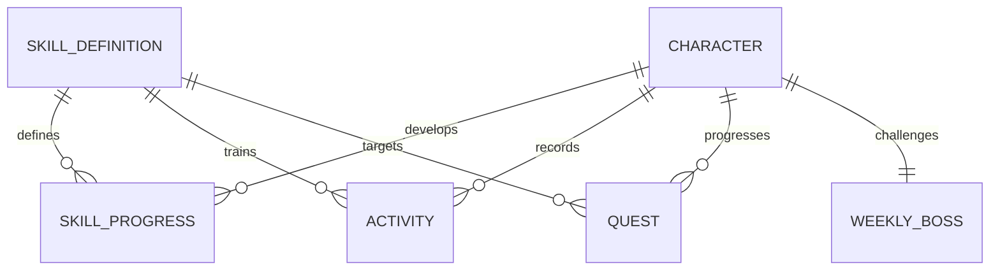

# Domain Model · V0.4

Stand: 2026-10-04. Implementierte Verträge sind gegen Domain, lokale Speicheradapter und Signal-State
abgeglichen. Spielbalance steht im [GDD](GAME_DESIGN.md), Render-/Assetvorgaben im
[Art Guide](ART_DIRECTION.md); künftige Tabellen sind ausdrücklich als Erweiterungen gekennzeichnet.

## Implementierter Slice

| Typ | Verantwortung / zentrale Felder |
|---|---|
| Character | ID, Name, Title, Gesamt-XP, Basisattribute, Appearance, createdByPlayer |
| CharacterProfile | Nur Name und Appearance; separat vom Fortschritt lokal gespeichert |
| Appearance | Visuelle Darstellung, optionale illustrierte Vorlage/Module/Paletten, bekannte Aura-ID und kompatible ältere Profilfelder |
| JourneyPreferences | Ausgewählte Interessen, primäre Richtung und aktive Skill-IDs; getrennt von CharacterProfile/GameSnapshot |
| SkillDefinition | ID, Name, Familie, Attribut, XP/Minute, Tageslimit, Symbol und Farbe; aktuell 14 Einträge |
| SkillProgress | Skill-ID + Gesamt-XP; Level wird berechnet |
| ActivityCommand | Request-ID, Skill-ID, ganze Minuten |
| Activity | Command plus belohnte Minuten, Day-Key und Aktivitäts-XP |
| Quest | ID, Skill-ID, Zielminuten, Fortschritt, einmaliger XP-Bonus, claimed |
| WeeklyBoss | ID, Name, Wochenlabel, Max-HP, aktuelle HP; Phase wird berechnet |
| Momentum im GameSnapshot | Wert 0–100, letzter belohnter Tag, Wochenrhythmus aus belohnten Aktivitätstagen |
| GameSnapshot | Aggregierter Zustand für das Dashboard inkl. Aktivitäten, Day-Key und erforderlichem `unlockedAuras: string[]` |
| GameProgressJournal / ProgressEntry | Version 1, Starttag, akzeptierte Commands mit lokalem Day-Key; lokaler Input-/Replay-Vertrag |
| AuraReward | ID, Label und einmalige Level-/Bossbedingung; drei implementierte kosmetische Belohnungen |
| ActivityResult | Neuer Snapshot + Aktivitäts-XP, Quest-XP, Damage, belohnte Minuten, duplicate |
| Milestone | Übergangsart, Titel und Detail; aus akzeptiertem Vorher/Nachher berechnet, nicht persistiert |
| SpriteRig / PortraitLayer | Reine Darstellungsdaten: Maße, Anker, Regionen, Layer und optionale Farbanpassung; keine Gameplay-Rechte |

Das Diagramm beschreibt fachliche Beziehungen; es behauptet kein bereits vorhandenes SQL-Schema.
Lokale Profil-/Journey-Speicherung ist derzeit gerätebezogen und gehört noch keinem Account.

## Künftige Account-Zuordnung als verbindliche Produktregel

Die Produktfassung erfordert Registrierung/Login und eine gültige Session, bevor ein Charakter
angelegt wird. Fachliche Reihenfolge: **Account → Character → Interessen-Onboarding → Dashboard**.
Ein authentifizierter Account ohne Character geht in die Erstellung. Der lokale Implementierungs-
slice oben enthält noch keinen Account/AuthSession-Vertrag und ist kein produktiver Gastmodus.

Der Server weist Character und dessen Aktivitäten, XP, Quests, Bossfortschritt, Aura-Besitz und
spätere Entitlements dem authentifizierten Account zu. Die Besitzer-ID kommt aus der geprüften
Session, nicht aus einer vom Client gelieferten Account-ID. `CharacterProfile` enthält weiterhin
nur Name/Appearance; es darf Eigentum nicht selbst beanspruchen. Eine fremde Character-ID umgeht
keine Besitzerprüfung. Ohne gültige Session ist Create unzulässig (401, keine Mutation).

Frontend-Guard und Session-basierte API-Autorisierung sind getrennte Anforderungen. Logout und
Accountwechsel müssen private Zustände, Entwürfe, Caches und verspätete Requests voneinander
isolieren. Die gegenwärtigen Browser-Journale haben keinen Accountbesitzer und werden nicht still
zu Account-Fortschritt migriert. Ein späterer Übernahmepfad braucht gesonderte Regeln. Auth-Provider
und Loginverfahren bleiben offen; eine öffentliche ungespeicherte Look-Vorschau ist bisher nur
mögliches Zukunftsthema und keine zugesagte Gastspielfunktion.

## Invarianten der Progression

- Minuten sind positive ganze Zahlen, XP/HP nichtnegative ganze Zahlen. Die Aktivitätseingabe
  erlaubt 1–180 Minuten; skillabhängige Tageslimits begrenzen die tatsächlich belohnten Minuten.
- Charakter-/Skill-Level und XP-in-Level werden aus Gesamt-XP abgeleitet, nicht doppelt gespeichert.
- Nur akzeptierte belohnte Minuten geben XP und Questfortschritt. Restliche Minuten bleiben im Log.
- Questbonus genau einmal. Questfortschritt ≤ Ziel; HP ∈ [0, maxHP]; Momentum ∈ [0, 100].
- Request-ID ist innerhalb des Charakters idempotent; abweichende Payload unter derselben ID ist Fehler.
- Ein unbekannter Skill oder ungültiger Command verändert keinen Teilzustand.
- Membership-Multiplikator, Item-Loot und Streak-Neuberechnung sind nicht implementiert. Lokale
  Tage/Wochen und drei kosmetische Aura-Grants sind vorhanden.
- Profil-/Journey-Mutationen sind unabhängig von Fortschritt: keine XP-, Skill-, Quest-, Boss- oder
  Momentumänderung. Fokuswechsel oder Ausblenden entfernen keine bestehenden Skill-XP.
- Meilensteine entstehen nur aus einem akzeptierten Übergang: Level, erster belohnter Tageseintrag,
  alle Dailies vollständig, Boss-Sieg oder neue Aura. Die Feier selbst gibt keine zusätzlichen XP.

## Charakterprofil und Appearance

`CharacterProfile { name, appearance }` wird an Formular-, Speicher- und Repository-Grenzen durch
`normalizeCharacterProfile` geprüft. Name: Unicode-NFC, getrimmt, zusammengefasste Leerzeichen,
2–24 Unicode-Codepoints. Er beginnt mit Buchstabe/Zahl; anschließend sind Buchstaben, kombinierende
Zeichen, Zahlen, Leerzeichen, Bindestrich und gerader/typografischer Apostroph erlaubt.

| Appearance-Feld | Aktueller Vertrag |
|---|---|
| `presentation` | Erforderlich: `male` oder `female`, ausschließlich visuelle Darstellung |
| `artwork?` | Typ akzeptiert `original`/`custom` für Kompatibilität; Normalisierung und Resolver verwenden immer `original` |
| `illustration?` | Bekannte Startdesign-ID passend zur Darstellung; fehlt das Feld, wählt der Renderer Smaragdwächter für male bzw. Nachtklinge für female |
| `illustratedHair?` | Bekannte Design-ID für die gewählte Frisur, passend zur Darstellung; fehlend folgt sie der Vorlage |
| `outfitSet?` | Bekannte Design-ID für das vollständige Outfitset, passend zur Darstellung; fehlend folgt es der Vorlage |
| `eyeColor?` | Eine der sechs erlaubten Augenfarben, normalisiert als kleingeschriebener Hexwert; fehlend bedeutet Original |
| `skinTone?` | Eine der sechs erlaubten Hautfarben; fehlend bedeutet Original |
| `hairTint?` | Eine der sechs erlaubten Haarfarben; fehlend bedeutet Original |
| `aura` | Erforderlich: `none`, `sage`, `rose`, `void`, `aurora`, `starlight` oder `moss-spirit`; Repository prüft verdienten Besitz separat |
| `body`, `hair`, `outfit` | Weiter erforderliche kompatible Profilfelder mit validierten älteren Options-IDs; kein eigener Vektor-Editor mehr in der UI |
| `skinColor`, `hairColor`, `outfitColor` | Weiter validierte sechsstellige Hexwerte älterer Profile; aktuelle illustrierte Farbauswahl verwendet die optionalen Palettenfelder oben |

Unbekannte IDs, fremde Darstellungskombinationen, unbekannte Palettefarben und `null` statt einer
zulässigen Option werden abgewiesen. Keine beliebigen Asset-URLs. Fehlende optionale Modul-/Farbwerte
bleiben in der normalisierten Appearance fehlend; lediglich `artwork` wird ausdrücklich auf
`original` gesetzt. Weibliche Originalvorlagen sind verfügbar und gültig. Das frühere `custom`
bezeichnet keinen weiterhin auswählbaren Editor-Modus.

`presentation` und Hauttöne beeinflussen keine Stats, XP, Skills, Berechtigungen oder reale Demografie.
Alle fünf Stilfamilien sind fachlich unabhängig von der Darstellung. Der aktuelle Katalog verwendet
je Darstellung passende Anker und Teile; das ist kein geschlechtsspezifisches Gameplay-System.

### Illustrierte Kataloge und Renderdaten

`ILLUSTRATED_CHARACTERS` enthält zwölf Design-IDs. Vorlage, Frisur und Outfitset nutzen denselben
Katalog, werden aber unabhängig aufgelöst:

| Darstellung | IDs |
|---|---|
| `male` | `emerald-knight`, `urban-ranger`, `frost-scholar`, `ember-striker`, `forest-scout`, `abyss-walker` |
| `female` | `moonblade`, `starweaver`, `dawn-priestess`, `rose-runner`, `void-sorceress`, `sky-ranger` |

Vier unveränderte Original-PNGs werden ohne Modul-/Farb-Overrides direkt mit Hintergrundmaske
komponiert. Jede explizite Modul-/Farbwahl aktiviert die modulare Bildvariante. Ein Vorlagenwechsel
entfernt diese Overrides; Name und Starter-Aura können bestehen bleiben. Neu erstellte Module sind
keine pixelidentische Zerlegung der vier ursprünglichen Bilder.

`SpriteRig` enthält ID, Breite/Höhe, Divider, Hals-/Fußanker und zwei Iriszentren, optional zwei
Irisradien-Paare. Es gibt zwölf Figuren-Rigs und zwei Basiskopf-Rigs. `PortraitLayer` enthält Region,
Kopf-/Körpergruppe, Bild-/Maskenpfad, Clip, Transformation, optionale Tönung und gegebenenfalls
explizite Iris-Ellipsen. Diese halten die Augenfarbfläche am ausgewählten Gesicht unabhängig von
Frisur und Outfit. Region/Anker sind Darstellungsdaten und kein Itembesitz.

Körper, Gesicht/Basiskopf und Haare sind getrennt komponierbar. Outfitsets sind vollständig bekleidet;
Waffen und befestigte Accessoires gehören zum Set. Einzelne Körper-/Rüstungsslots, Mimik, Waffenwahl
und Item-Loot sind noch nicht implementiert. Die aktuelle Atmung bewegt Körper/Kopf gekoppelt und ist
abschaltbar; vorläufige Levelbereiche 1–9 / 10–24 / 25+ verändern keine Progressionsregel.

### Lokale Hülle und Migration

Profilversion 2 verwendet `{ version: 2, profile }` unter `everbloom.character.v2`. XP, Interessen,
Auth-Tokens und Kaufberechtigungen gehören nicht in diese Hülle. Ein bestätigter Reset erhält das
übrige Profil und entfernt eine angelegte verdiente Aura. Fortschritt hat ein getrenntes Journal.
Kaputte oder unbekannte Profilhüllen werden ignoriert; Journalfehler werden gesondert behandelt.

Gültige Version 1 wird bei fehlendem V2-Eintrag aus `everbloom.character.v1` gelesen. Fehlende
Darstellung wird technisch als `male` gesetzt, ohne Ableitung aus Name, Hautfarbe oder Aktivitäten.
Die Legacy-Haarzuordnung lautet für male `tousled` → `m-spiky`, `bob` → `m-curtains`, `braid` →
`m-topknot`; bei ausdrücklich vorhandener female-Darstellung `tousled` → `f-pixie`, `bob` → `f-bob`,
`braid` → `f-braid`. Die kompatiblen Haar-IDs werden weiterhin passend zur Darstellung validiert.

Die Migration ruft anschließend die aktuelle Normalisierung auf; auch alte `custom`-Profile werden
zum illustrierten Pfad `original` überführt. Zulässige übrige Profilwerte bleiben erhalten, werden
aber nicht als weiterhin wirkende Vektor-Editor-Regler versprochen. Beim Legacy-Lesen versucht der
Adapter die V2-Hülle bereits zu speichern, ohne den V1-Eintrag zu löschen. Gesperrter Speicher lässt
den normalisierten Sitzungsstand nutzbar; der Store erklärt fehlende dauerhafte Speicherung.

## JourneyPreferences und 14er-Skillkatalog

`JourneyPreferences` liegt in `domain/journey.ts`, außerhalb von CharacterProfile und GameSnapshot:

| Feld | Invariante |
|---|---|
| `interestIds` | 1–7 bekannte, eindeutige Interessen-IDs; Auswahlreihenfolge bleibt erhalten |
| `activeSkillIds` | 1–6 bekannte, eindeutige Skill-IDs aus dem 14er-Katalog; Auswahlreihenfolge bleibt erhalten |
| `primaryInterestId` | Muss in `interestIds` enthalten sein |

Interessen: `physical`, `combat`, `mind`, `knowledge`, `creative`, `career`, `life`. Die Defaults
wählen physical/mind/knowledge, primär physical, und die vier aktiven Skills Calisthenics, Running,
Meditation, Programming. Der aktuelle Katalog ergänzt Weightlifting, Swimming, Boxing, BJJ,
Breathwork, Recovery, Reading, Languages, Healthy Cooking und Instrument üben (`music`).
Die ursprünglichen vier XP-Raten, Tageslimits und Seedstände bleiben unverändert; die zehn neuen
Skills starten mit 0 XP. Die [Balance-Tabelle](GAME_DESIGN.md#skills-und-subskills) ist maßgeblich.

`normalizeJourneyPreferences` erzeugt neue Arrays und übernimmt ausschließlich die drei Felder.
`JourneyPreferencesStorage` speichert `{ version: 1, preferences }` unter `everbloom.journey.v1`.
`JourneyStore` hält Auswahl, Konfigurations-/Persistenzstatus und Rückmeldung. Ungültige Eingaben
verändern nichts; blockierter Speicher ermöglicht einen ausdrücklich bezeichneten Sitzungsstand.
Kein Journey-Command ruft die Progressionsmutation auf.

Das Onboarding bearbeitet Interessen, Fokus und Zusammenfassung. Ein flüchtiger `OnboardingDraft`
erhält Auswahl/Schritt beim Abstecher zum Creator, ohne zusätzliche Browser-Speicherung. `GameStore`
filtert seine Fokus-View anhand aktiver IDs, lässt alle Skills im Snapshot aber bestehen. Das
Avatarinteresse bevorzugt den letzten belohnten Skill; sonst die konfigurierte primäre Richtung,
ansonsten `adventurer`. Keine automatische Diagnose, Stats oder Rewards aus Interessen.

## Aura-Besitz und ungespeicherte Vorschau

`AURA_REWARDS` enthält drei `AuraReward`-Einträge; `AURA_PROGRESSION_PLAN` exportiert denselben Katalog.
`STARTER_AURA_IDS` umfasst `none`, `sage`, `rose`, `void`, die ohne Besitzliste verfügbar sind.
`hasAuraAccess(snapshot, id)` erlaubt nur Starter oder eine bekannte Belohnung in `unlockedAuras`.
Unbekannte/Vorschau-IDs bleiben selbst bei einem manipulierten Listeneintrag nicht anlegbar.

`grantActivityAuras(before, after, activityXp)` läuft innerhalb des akzeptierten `recordActivity`-
Schritts. Positive endliche Aktivitäts-XP und zunehmende Charakter-XP sind Voraussetzung. Nordlicht
(`aurora`) entsteht beim Übertritt auf mindestens 57.000 Gesamt-XP (Level 20), Sternenkranz (`starlight`) auf
mindestens 195.000 (Level 40), jeweils einschließlich Quest-XP. Moosseele (`moss-spirit`) entsteht bei
`mosswarden`-HP > 0 → 0 derselben Begegnung. Gleichzeitige Grants sind möglich, jede ID nur einmal.
Bloße hohe Startlevel, Laden, fehlende Aktivitäts-XP, andere/schon besiegte Bosse und Duplikate
vergeben keine neue Aura. Der Grant ändert keine XP-/Damage-Raten.

Besitz ist ein abgeleiteter Teil des Snapshots und wird aus dem Journal wiederhergestellt, nicht
als vertrauenswürdige freie Besitzliste geladen. `normalizeCharacterProfile` kennt die Reward-IDs;
`MockGameRepository.updateCharacter` prüft zusätzlich `hasAuraAccess`. Beim Laden/Reset fällt allein
eine nicht mehr besessene angelegte Aura auf `none` zurück. Der Rest des Profils bleibt erhalten.
Neue Grants erzeugen `Milestone.kind = 'aura-unlock'` mit lesbarem Namen; Replay und Reset feiern nicht.
Lokaler Besitz ist noch kein authentifizierter Servernachweis.

`AURA_DESIGNS` enthält drei Starter-Effekte, drei verdiente Auren (`previewOnly: false`) und zehn
weitere Entwürfe (`previewOnly: true`). Der Creator hält deren `previewAura`, `previewColor` und
`previewFierce` ausschließlich als temporäre Signale. Sie landen weder in Appearance/Journey noch
im Repository. Normale Aura-Auswahl beendet die Vorschau; Vorschau verändert keine XP, Quests,
Bosswerte oder Rechte. Der bedrohliche Blick sitzt derzeit im hinteren Dämonenschatten, nicht in
den echten Avataraugen. Eigene Gesichtsmimik/Iris-VFX sind spätere Felder.

## Lokales Aktivitätsjournal und Spielperioden

`GameProgressJournal { version: 1, startDay, entries }` liegt unter `everbloom.progress.v1`.
`ProgressEntry` enthält exakt `requestId`, `skillId`, `minutes`, `dayKey`. Bekannte Skills, 1–180 ganze
Minuten, valide Kalendertage in nicht fallender Reihenfolge und eindeutige Request-IDs (maximal
128 Zeichen, keine Steuerzeichen) werden validiert. Maximal 10.000 Einträge und 2 MiB; keine XP-,
HP-, Quest- oder Besitzfelder sind erlaubt. Auch unvergütete Minuten bleiben als akzeptierter
Input erhalten. Unbekannte Version/Schlüssel und defekte Eingaben werden nicht partiell übernommen.

Der Adapter startet mit demselben Level-12-Beispielseed am gespeicherten `startDay` und spielt die
Commands mit `advanceGamePeriod` → `recordActivity` erneut ab. Danach wird bis zum aktuellen lokalen
Tag vorgerückt. Gleiches Journal und gleiche Regeln ergeben denselben Zustand; Replay sendet kein
Erfolgsfeedback. Regeländerungen brauchen künftig eine dokumentierte Versionierung/Migration.

`startGamePeriod` datiert den Beispielstart, ohne dessen Bosswerte neu zu erfinden.
`advanceGamePeriod` bewegt den Tag nur vorwärts, setzt Dailies am neuen Tag auf 0/ungeclaimt und
Boss-HP in einer neuen Montag–Sonntag-Woche auf Maximum. Aktivitäten, XP und `unlockedAuras` bleiben
bestehen. Der Rhythmus verwendet die aktuelle Woche und belohnte Tage; vergangene Tage ohne
belohnte Aktivität sind `rest`, der heutige Tag `today`, künftige `upcoming`. Das ist keine Streak-
oder geplante Ruhetagsberechnung. Das Repository weist neue Einträge bei ungültigem/zurückgestelltem
Datum ab. Die Geräteuhr ist trotzdem keine vertrauenswürdige Serverzeit.

`ProgressPersistenceStatus` trennt `saved`, `session`, `unavailable`, `corrupt`, `unsupported`,
`limit`, `clock` mit sichtbarer Meldung. Defekte/fremde Journale bleiben unangetastet, bis ein
expliziter Reset sie ersetzt. Zweite Tabs werden nicht still überschrieben. Ein bestätigter Reset
ersetzt das Journal durch einen leeren Start für heute und löscht dadurch Fortschritt und verdiente
Auren; übriges Profil, Interessen und getrennte Präferenzen bleiben. Schreibfehler beim Reset
lassen den vorhandenen Spielstand bestehen. Kein Account, Cloud-Sync oder produktiver Audit-Nachweis.

## Tagesvorschläge und abgeleitete Wochenziele

`buildDailyAdventure(snapshot, focusSkillIds, careMode = 'balanced')` aus
`domain/daily-adventure.ts` ist eine reine Projektion ohne Speicheradapter. `DailyAdventure` enthält
`dayKey`, `mode`, `restFriendly`, bis zu drei `recommendations` und `week`.

`DailyRecommendation` beschreibt Skill-ID/-Name, Familie, Symbol, Farbe, Titel, Beschreibung,
Minuten, `kind: 'quest' | 'focus' | 'care'`, optionale `questId`, noch belohnbare Tagesminuten und
`preview: { activityXp, questXp, totalXp, bossDamage }`. Die Vorschau verwendet `recordActivity`
mit einer kollisionsfreien temporären Request-ID, verwirft jedoch dessen neuen Snapshot. Sie vergibt
keine Auren und schreibt keinen Eintrag. Das UI darf nur das Eingabeformular vorausfüllen; erst der
gewöhnliche bestätigte Activity-Command darf persistieren.

Fokusreihenfolge bleibt erhalten; unbekannte, doppelte und nicht im Snapshot vorhandene Skill-IDs
werden ignoriert. Ohne Fokusliste wird die vorhandene Skillreihenfolge genutzt. Erholung und Ruhetag
wählen stattdessen vorhandene Recovery-, Meditation- und Breathwork-Skills. Vorschläge enthalten
5–20 ganze Minuten, im Ruhetag fünf, begrenzt auf noch belohnbare Tagesminuten. Sind alle Quests eines
Skills abgeschlossen oder weniger als fünf Minuten belohnbar, entfällt dessen Vorschlag. Fokuswahl,
fehlende Vorschläge und Care-Modus löschen keinen bereits vorhandenen Fortschritt.

`AdventureWeek` enthält Montag/Sonntag, Wochenlabel, `activityXp`, `activeDays`, `skillCount`,
`familyCount`, `careDays` und drei `WeeklyMilestone`-Werte. Es zählen bekannte Skills mit positiven
ganzzahligen XP/belohnten Minuten, gültigem Day-Key innerhalb dieser Woche bis heute und eindeutiger
Request-ID. Tage, Skills und Familien werden als Mengen gezählt; ein Care-Tag verlangt einen
Recovery-, Meditation- oder Breathwork-Eintrag. Ein Check-in allein zählt nicht. Die Wochensumme
enthält ausschließlich protokollierte Aktivitäts-XP, keine geschätzten historischen Questboni.

`WeeklyMilestone` enthält ID, Titel, Beschreibung, auf das Ziel begrenzten Fortschritt, Ziel,
`complete` und festes `rewardXp: 0`. Ziele: drei belohnte Tage, zwei verschiedene Skill-Familien,
ein Care-Tag. Diese Lesemodelle sind keine persistierten Weekly-Quest-Instanzen, Claim-Commands,
Achievements oder Kaufrechte; ein Wochenwechsel ändert nur die abgeleitete Ansicht.

## Kampfübung und Actor-Darstellung

Die neue Kampfübung verwendet einen vom Fortschritt getrennten, flüchtigen Vertrag:
Startwerte beider Kämpfer → deterministischer Zugverlauf → Ergebnis. Charakterlevel und
erworbene Skill-Erfahrung fließen in die Startwerte ein. Der Snapshot wird gelesen und nicht
verändert; neue Profil- oder Fortschrittswerte während der Wiedergabe schreiben einen bereits
begonnenen Verlauf nicht um. Kampfbalance ist vorläufig und getrennt von der aktuellen
Aktivitäts-XP-/Wochenbossregel.

Invarianten: kein Zufall aus `Math.random`, keine Uhr-/Browserabhängigkeit in der Domain; gleicher
Start ergibt denselben Verlauf. HP liegen zwischen null und Maximum, Schaden ist nachvollziehbar
und die Simulation hat ein Ende. Die Übung verändert weder XP noch Aktivitäten, Quests,
Wochenboss-HP oder Aura-Besitz. Neustart ist eine weitere Vorschau, kein neuer Reward-Command.
Kampfergebnis und Wiedergabeposition werden nicht im Aktivitätsjournal gespeichert.

Aktuelle Typen in `domain/auto-battle.ts`:

| Typ | Inhalt |
|---|---|
| `CombatStats` / `HeroCombatStats` | Level, maximale HP, Angriff, Verteidigung; Held zusätzlich Attribute und Fokusschlagrhythmus |
| `BossCombatDefinition` | Eigenständige Gegner-ID, Name und Übungswerte; keine Mutation von `WeeklyBoss` |
| `BattleTurn` | Index/Runde, handelnde Seite, Aktion, tatsächlicher Schaden, tatsächliche Heilung, HP beider Seiten und anschließende Bossphase |
| `BattleReplay` | `mode: 'practice'`, Taktik, eingefrorene Startwerte, Zugliste, Sieg/Niederlage/Unentschieden, Rundenanzahl und feste Null-Rewards |
| `BattleTactic` | `balanced`, `power` oder `guard`; ausschließlich vor Beginn beziehungsweise bei erneuter Vorbereitung gewählt |

`deriveHeroCombatStats` und `createPracticeBattle` sind die reinen Einstiege. Bekannte Skills werden
über den begrenzten Katalog gelesen; unbekannte oder doppelte IDs können nicht zusätzlich zählen.
Die [Kampfbalance](GAME_DESIGN.md#automatische-begegnungen-und-separate-kampfübung) bleibt separat
versioniert. Der Renderer erzeugt keine zusätzlichen Treffer, wenn ein Clip mehrfach läuft.

`PracticeBattleOptions.tactic` wählt den deterministischen Ablauf. Offensiv multipliziert Angriff
mit 1,2 und Verteidigung mit 0,75; Ausdauer mit 0,85 beziehungsweise 1,25; jeweils abgerundet und
innerhalb der bestehenden Schutzgrenzen. Balance lässt die bisherige Berechnung unverändert.
Ausdauer ersetzt in jeder dritten Runde bei weniger als 60 % Max-HP den Angriff durch `renewal`:
`floor(0,12 × Max-HP + 0,5 × Recovery + 0,25 × Mindfulness)`, mindestens ein Punkt und höchstens
die fehlenden HP. Der Turn hat `damage: 0`, positive `healing`, `critical: false`; der Boss erhält
danach seinen normalen Zug. Alle anderen Turns haben `healing: 0`. Ein Erholungszug erzeugt weder
reale Care-Aktivitäten noch XP. Taktik, virtuelle Heilung und Ergebnis bleiben außerhalb des Journals.

Ein Darstellungs-Actor repräsentiert `hero` oder `boss` und reagiert auf `idle`, `attack`, `hit`,
`victory`, `defeat`. Posen, Bones, Texturen, Bounds und Ausrichtungen sind Renderdaten, keine
Progressionsrechte. Hero und Boss teilen Aktionen, nicht zwangsläufig Skeleton oder Körperform.
Der bisherige `SpriteRig` bleibt ein Bild-/Maskenvertrag und wird durch die neue Bezeichnung
nicht automatisch zu einem vollständigen animierten Skelett.

Künftige produktive `BossEncounter`-Daten benötigen Encounter-ID, Charakter/Account, zugelassene
Aktivitätsquelle, Regelversion, Startsnapshot, Ergebnis und Status der genau einmaligen
Reward-Vergabe. Das ist ein Ausbauvertrag, noch kein vorhandener DB-/API-Typ. Ein vom Client
gemeldeter Sieg gilt nicht als autorisiertes Ergebnis. Bestehende Journale und Aura-Grants
erfordern bei Umstellung eine explizite versionierte Migration.

## Darstellung und Browserpräferenzen

`Celebration` gruppiert Meilensteine mit Meldungs-ID, Titel, Details und Vorschaukennzeichen.
Ton, Feuerwerk und Charakterbewegung liegen separat unter `everbloom.feedback.v1`, außerhalb von
CharacterProfile, Journey und GameSnapshot. Sie erzeugen keine Rewards und verändern keine
Aktivitätsprüfung. Bewegung aus und `prefers-reduced-motion` gelten für Avatar und Aura.
Dekorative Gradienten, Partikel und gekoppelte Atmung sind keine eigenen Domain-Aktivitäten.

## Freiwilliger Tages-Check-in

Ein `DailyCareRecord` mit Version 1 enthält lokalen `dayKey`, `skipped` und optional
`DailyCheckIn { dayKey, mode, energy }`. Modi: `balanced`, `focus`, `recovery`, `rest`;
Energie: `low`, `steady`, `high`. Keine Ableitung von Gesundheit oder Fähigkeiten.
`DailyCareStore` speichert ausschließlich unter `everbloom.daily-care.v1`. Tageswechsel wird
beim Öffnen, Fokus/Resume und vor Commands geprüft. Eine defekte oder abgelaufene Auswahl
beginnt eine neue freiwillige Frage. Fehlende Schreibrechte behalten die aktuelle Sitzungsauswahl.
Keine XP, Quests, Boss, Rhythmus- oder Momentum-Werte werden verändert. Aktivitätsperioden nutzen
unabhängig davon ebenfalls das lokale Datum; der Check-in bleibt vom Progressionspfad getrennt.

## Erweiterungen und spätere Tabellen

`users` 1:1 `characters`; `skill_definitions` mit optionaler Parent-ID; `character_skills`;
`activity_logs` (unique user/request); `quest_definitions` + `quest_instances` (user/period);
`boss_definitions` + `boss_encounters`; später `day_plans`, `inventory_items`, `equipment_slots`,
`cosmetics`, `achievements`, `character_achievements`, `titles`, `entitlements`.

Das Equipment-Ziel umfasst vollständige Sets sowie Kopf, Gesicht, Haare, Torso, Arme, Beine,
Schuhe, Haupthand, Nebenhand, Rücken, Accessoire, Aura und Companion. Jeder Einzelslot benötigt
einen eigenen Vertrag; vorhandene Körper-/Haarmasken sind keine automatische Slot-Implementierung.

Ein servergeführtes Aktivitätslog ist der künftige Audit-Pfad; das lokale Journal ist kein solcher Nachweis. Abgeleitete Projektionen (XP, Quest, Boss) werden
serverseitig transaktional aktualisiert. Member-Zugang gehört zu Entitlements, kosmetischer Look
zu Appearance, Skill-Level zu Progression. Keine gemeinsame „alles kann alles“-Entity.
Für Streaks braucht es Zielrhythmus, geplante Tage und abgeschlossene Perioden. Weekly Quests
brauchen einen expliziten Periodenschlüssel; aktuell existieren ausschließlich Tagesquests.
Der Account-Grundbaustein (Accounttabelle, BCrypt-Hash, Session, CSRF und Logout) ist als Backend-
Slice vorhanden. Character, serverautoritatives Aktivitätslog, Synchronisierung und die übrigen
Spielprojektionen sind noch nicht implementiert.
